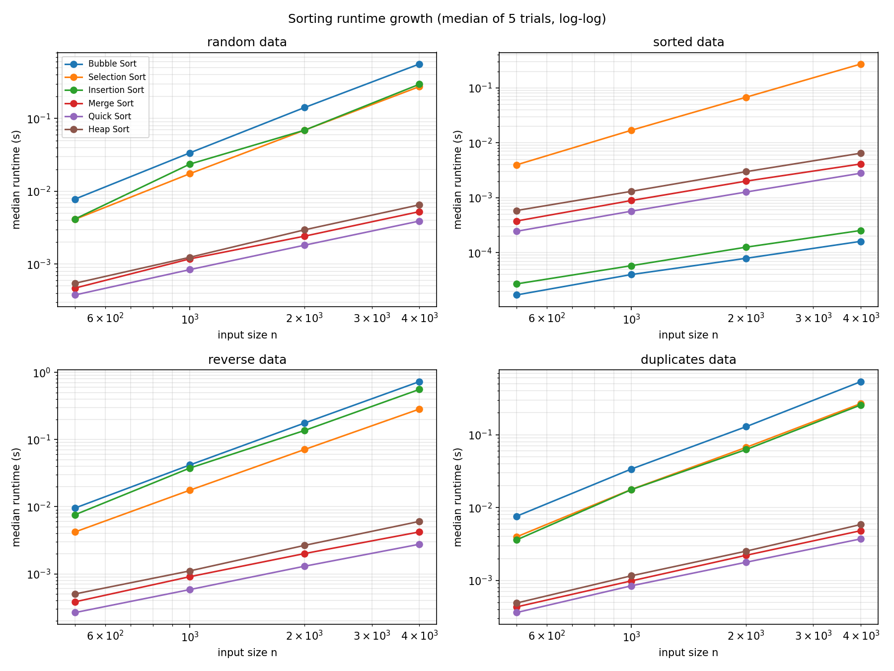

# Laboratory Activity No. 11: Sorting Algorithms and Performance Benchmarks

**Course:** CPEPRO8L – Data Structures and Algorithms  |  **Term:** First Semester, AY 2026–2027

## Objectives
1. Implement Bubble, Selection, Insertion, Merge, Quick and Heap Sort without built-in sorting.
2. Verify correctness on empty, one-item, duplicate, sorted, reverse-sorted and random datasets.
3. Measure and compare execution time across input sizes and data distributions.
4. Relate measured behavior to expected time and space complexity.

## Environment
- Python 3.12 (3.11+ required), Linux
- Standard modules: `random`, `time`, `statistics`, `copy`, `csv`, `unittest`
- `matplotlib` (chart only): `pip install matplotlib`

## Execution Commands
```
python test_sorts.py          # correctness tests
python benchmark_sorts.py     # writes results.csv and runtime_chart.png
```

## Implementation Summary
| Algorithm | Stable | Extra space | Notes |
|---|---|---|---|
| Bubble | Yes | O(1) | Early exit when a pass makes no swap |
| Selection | No | O(1) | At most n−1 swaps |
| Insertion | Yes | O(1) | Shift-based, O(n) on sorted input |
| Merge | Yes | O(n) | Top-down, one buffer allocated once |
| Quick | No | O(log n) stack | **Median-of-three pivot**, Hoare partition, recurse on smaller side |
| Heap | No | O(1) | In-place max-heap |

Counters: `comparisons` = key-vs-key comparisons; `movements` = element writes/swaps (a swap = 1).

## Benchmark Design (fairness controls)
- Datasets generated once per (size, condition) from fixed seed 2026; every algorithm sorts identical values.
- Each trial sorts a fresh `list.copy()` made outside the timed region.
- Only the sort call is timed with `time.perf_counter()`; 5 trials per algorithm/condition; **median** reported.
- Output verified against `sorted()` after each run (outside timing; reference check only).
- Sizes: 500, 1000, 2000, 4000. Duplicate-heavy data has only 10 distinct values.
- Skip rule: a quadratic algorithm would be skipped at larger sizes after a run exceeded 20 s. **No runs were skipped** (slowest run was under 1 s).
- Counters add a small constant overhead to every algorithm equally.

## Test Results
`python test_sorts.py` → **Ran 4 tests … OK** (all six algorithms on 9 datasets, counter sanity, linear behavior on sorted input for Bubble/Insertion, and stability of Bubble/Insertion/Merge). No failures occurred during development.

## Results
Raw data: `results.csv`. Console capture: `benchmark_output.txt`.

**Random data** – median runtime in milliseconds (5 trials)

| Algorithm | n=500 | n=1000 | n=2000 | n=4000 |
|---|---:|---:|---:|---:|
| Bubble Sort | 7.825 | 33.756 | 141.657 | 561.052 |
| Selection Sort | 4.126 | 17.465 | 69.262 | 274.385 |
| Insertion Sort | 4.171 | 23.645 | 69.146 | 295.658 |
| Merge Sort | 0.469 | 1.180 | 2.422 | 5.262 |
| Quick Sort | 0.377 | 0.840 | 1.821 | 3.906 |
| Heap Sort | 0.546 | 1.241 | 2.960 | 6.526 |

**Sorted data** – median runtime in milliseconds (5 trials)

| Algorithm | n=500 | n=1000 | n=2000 | n=4000 |
|---|---:|---:|---:|---:|
| Bubble Sort | 0.017 | 0.040 | 0.079 | 0.161 |
| Selection Sort | 3.967 | 16.911 | 67.660 | 272.063 |
| Insertion Sort | 0.027 | 0.058 | 0.126 | 0.254 |
| Merge Sort | 0.377 | 0.890 | 2.007 | 4.125 |
| Quick Sort | 0.245 | 0.569 | 1.271 | 2.798 |
| Heap Sort | 0.585 | 1.307 | 2.984 | 6.480 |

**Reverse data** – median runtime in milliseconds (5 trials)

| Algorithm | n=500 | n=1000 | n=2000 | n=4000 |
|---|---:|---:|---:|---:|
| Bubble Sort | 9.543 | 41.782 | 176.052 | 728.484 |
| Selection Sort | 4.203 | 17.599 | 71.028 | 284.338 |
| Insertion Sort | 7.586 | 37.587 | 136.437 | 557.166 |
| Merge Sort | 0.383 | 0.907 | 2.005 | 4.209 |
| Quick Sort | 0.265 | 0.583 | 1.299 | 2.758 |
| Heap Sort | 0.502 | 1.106 | 2.655 | 6.036 |

**Duplicates data** – median runtime in milliseconds (5 trials)

| Algorithm | n=500 | n=1000 | n=2000 | n=4000 |
|---|---:|---:|---:|---:|
| Bubble Sort | 7.593 | 33.772 | 128.825 | 535.322 |
| Selection Sort | 3.956 | 17.717 | 66.925 | 267.572 |
| Insertion Sort | 3.594 | 17.622 | 62.494 | 256.072 |
| Merge Sort | 0.433 | 0.985 | 2.213 | 4.819 |
| Quick Sort | 0.362 | 0.843 | 1.776 | 3.718 |
| Heap Sort | 0.489 | 1.157 | 2.521 | 5.858 |

**Comparisons and movements at n = 4000**

| Algorithm | Random cmp | Random mov | Sorted cmp | Sorted mov | Reverse cmp | Reverse mov |
|---|---:|---:|---:|---:|---:|---:|
| Bubble Sort | 7,995,299 | 4,019,446 | 3,999 | 0 | 7,998,000 | 7,998,000 |
| Selection Sort | 7,998,000 | 3,987 | 7,998,000 | 0 | 7,998,000 | 2,000 |
| Insertion Sort | 4,023,439 | 4,023,435 | 3,999 | 0 | 7,998,000 | 8,001,999 |
| Merge Sort | 42,861 | 95,808 | 23,728 | 95,808 | 24,176 | 95,808 |
| Quick Sort | 73,714 | 11,533 | 63,900 | 0 | 63,901 | 2,000 |
| Heap Sort | 83,429 | 44,338 | 86,576 | 47,142 | 80,151 | 41,436 |



## Guide Questions

**1. Which elementary algorithm benefited most from already sorted data, and why?**
Bubble Sort and Insertion Sort both collapsed to linear time (n=4000: ≈0.16 ms and ≈0.25 ms versus 560 ms and 296 ms on random data), using only n−1 = 3,999 comparisons and zero movements. Bubble Sort's early-exit flag ends after one pass; Insertion Sort finds every element already in place after one comparison. By measured time Bubble Sort was marginally fastest on sorted data (a pass of simple compares), but both gained roughly 1000×+. Selection Sort gained nothing (7,998,000 comparisons regardless) because it always scans the whole unsorted part.

**2. How did the Quick Sort pivot strategy affect sorted or duplicate-heavy data?**
Median-of-three picks the true middle value on sorted/reverse input, so partitions stay balanced and the runtime on sorted data (2.8 ms at n=4000) was actually *lower* than on random data (3.9 ms), with 0 swaps. The Hoare partition stops on keys equal to the pivot, so duplicate-heavy data (10 distinct values) still split evenly and ran in 3.7 ms. A first- or last-element pivot with a Lomuto partition would degrade to O(n²) on sorted input and be prone to it on heavy duplicates.

**3. Why is median runtime preferable to a single timing result?**
A single timing can be inflated by OS scheduling, garbage collection, CPU frequency changes or cache warm-up. The median ignores such outliers, unlike the mean, and is more repeatable than one measurement or the minimum.

**4. What memory trade-off does Merge Sort make compared with in-place alternatives?**
Merge Sort guarantees O(n log n) time and stability but needs an O(n) auxiliary buffer (here one list the size of the input). Heap Sort and Quick Sort sort in place with O(1) and O(log n) extra space respectively, at the cost of stability. Merge Sort also performed about 2n·log n element writes (95,808 at n=4000) versus 11,533 swaps for Quick Sort on random data.

**5. When might an O(n²) algorithm still be reasonable?**
For small inputs (tens of items), where low constant factors and simplicity beat the overhead of recursion or heaps; for nearly sorted data (Insertion Sort is near-linear, which is why it is used for small partitions in hybrid sorts); when memory is very constrained (O(1) space); and when writes are expensive, where Selection Sort's at most n−1 swaps (3,987 at n=4000 random) is attractive.

**6. Which measured result differed most from the theoretical expectation, and what likely caused it?**
Theory treats Bubble, Selection and Insertion as the same O(n²) class, yet at n=4000 on random data Bubble Sort (561 ms) was nearly 2× slower than Insertion (296 ms) and Selection (274 ms). Bubble Sort performs about n²/4 swaps (≈4.0 million) in addition to n²/2 comparisons, and each swap is a more costly Python operation than Selection's comparison-only inner loop. A second deviation: Heap Sort was ≈1.7× slower than Quick Sort and ≈1.2× slower than Merge Sort despite all being O(n log n), due to heap sifting's scattered memory access and higher constant factor in interpreted Python. Also, Merge Sort comparisons dropped on sorted data (23,728 vs 42,861) because it finishes merges early — a best-case effect not visible in its O(n log n) bound.

## Conclusion
All six implementations passed every correctness dataset. The measurements agree with theory: the O(n²) sorts grew about 16× when n grew 4× (e.g., Selection 17.5 → 274 ms for n=1000 → 4000) while the O(n log n) sorts grew about 4–5×. Input distribution mattered mostly for the adaptive sorts (Bubble, Insertion) and for pivot choice in Quick Sort. Quick Sort with median-of-three was fastest overall, Merge Sort traded O(n) memory for stability and guaranteed bounds, and Heap Sort gave guaranteed O(n log n) with O(1) extra space but the highest constant factor.

## Files Submitted
- `sorting_algorithms.py` – six algorithms with counters
- `test_sorts.py` – correctness test suite
- `benchmark_sorts.py` – controlled benchmark
- `results.csv` – raw results (median/min/max, counts)
- `benchmark_output.txt` – console capture
- `runtime_chart.png` – runtime growth chart
- `README.md` – this report
